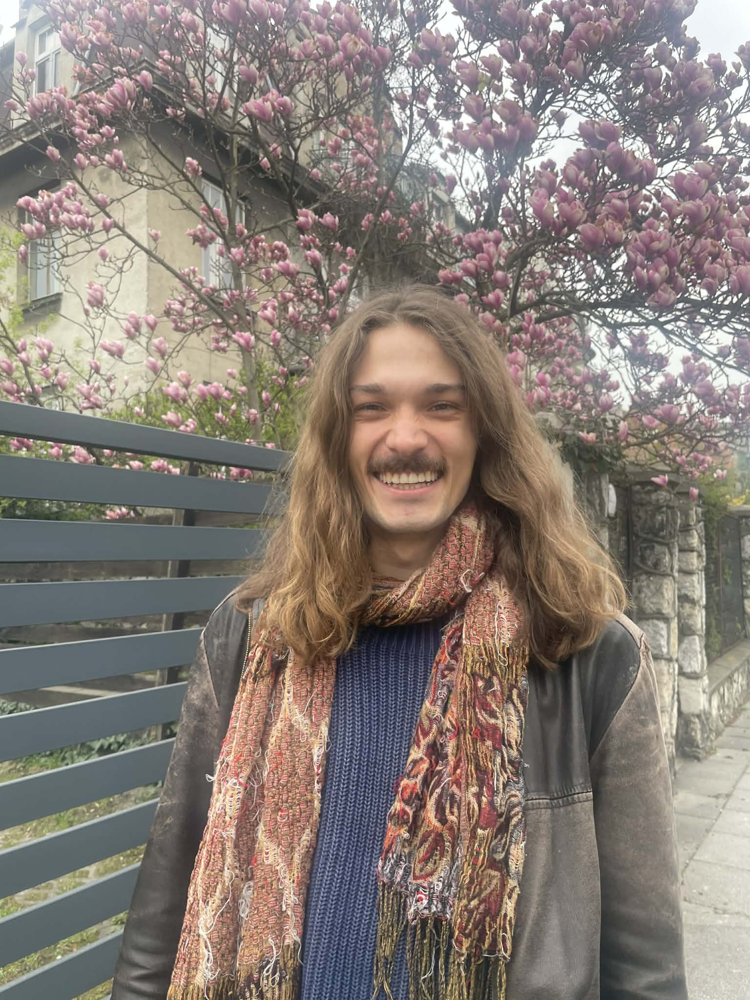

## Bio

::::: {.about-intro}
:::: {.about-intro-text}
Hi, I’m Jan! I completed an MSc in Mathematics and Foundations of Computer Science at the University of Oxford in September 2026, where I wrote my dissertation under the supervision of [Professor Andrzej Murawski](https://www.cs.ox.ac.uk/andrzej.murawski/). Before that, I earned a BSc in Mathematics and Philosophy from the University of Warwick.

My interests lie at the intersection of theoretical computer science and pure mathematics. I'm particularly fascinated by programming language semantics: how we can use mathematical structures to describe computation and reason about the behaviour of programs. Along the way, I enjoy exploring connections with mathematical logic, type theory, category theory, and topology.

You can find more about my work, including my master's dissertation on contextual equivalence, on my **Projects** page.
::::

::: {.about-intro-photo}
{.about-portrait fig-alt="Portrait of Jan Galek"}
:::
:::::
My CV is available [here](files/CV_Jan_Galek.pdf).

Email: jangalekk at gmail.com.

